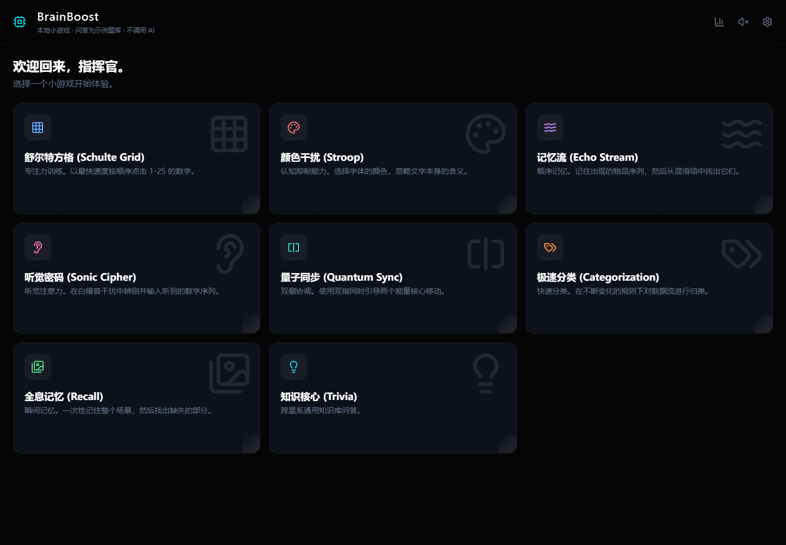

# BrainBoost · 浏览器脑力小游戏

一个科幻风格的本地小游戏集合：从按顺序寻找数字、辨别文字颜色，到记忆序列和快速分类，用几分钟体验不同的交互规则。游戏记录保存在当前浏览器，不需要注册、数据库或共享 API 密钥。

[直接体验](https://yangwei251003.github.io/brainboost/) · [MIT](LICENSE) · [浏览器验收](docs/browser-check.json)



## 公开版范围

**这是远端原有 React / Vite 网页项目。** 本机另有同名 Flutter 工程，属于不同项目，没有覆盖或合并到这里。

公开版的小游戏在浏览器运行。知识问答使用明确标识的本地固定示例题库，**不调用 Gemini 或其他 AI 模型**；三种难度选择不同示例题组，不宣传自动生成新题。原先会把模型密钥写入浏览器包的构建配置和云 SDK 已移除。

| 模块 | 玩法 |
|---|---|
| 舒尔特方格 | 按数字顺序点选；难度改变初始方格尺寸 |
| 颜色干扰 | 按文字实际显示的颜色作答 |
| 记忆流 | 观察并重现图标出现顺序 |
| 听觉密码 | 聆听并输入数字序列，需要浏览器与系统语音支持 |
| 量子同步 | 同时移动两个目标，需要合适的指针或触屏输入 |
| 极速分类 | 按当前规则分类对象 |
| 全息记忆 | 观察场景并找回目标 |
| 知识核心 | 15道本地科学、技术与数学示例题，按难度分组 |

“游戏表现记录”汇总本浏览器的场次、分数、用时与模块记录；这些是游戏统计，不是认知能力或神经测量。空记录不会显示虚构等级。

## 快速上手

准备 **Node.js 24 LTS** 与 npm，在仓库根目录运行：

```bash
npm ci
npm run dev
```

浏览器打开终端显示的地址，默认 `http://localhost:3000`。不需要创建 `.env`，也不要向浏览器项目添加私人模型密钥。

生产构建与本机预览：

```bash
npm run typecheck
npm run build
npm run preview
```

`dist` 是可静态托管的构建结果；GitHub Actions 会从源码重建并发布 GitHub Pages。网页代码、样式、原创纹理和合成音乐均由同一站点提供，不依赖 CDN 或云模型。首次访问仍需从托管站点获取文件，本版没有安装型 Service Worker 离线缓存。

## 目录结构

```text
components/     各小游戏、教程、难度、暂停和设置组件
screens/        首页、游戏流程与本机游戏记录
services/       浏览器存储与本地示例题库
public/         原创纹理及本地合成氛围音
scripts/        浏览器运行检查
docs/assets/    本轮真实页面截图
.github/        从源码构建、发布静态站点
```

## 可复现的浏览器检查

```bash
npx playwright install chromium
npm run check:browser
```

检查脚本在随机本机端口下模拟 `/brainboost/` 仓库子路径，覆盖8个模块入口、舒尔特初级三关、5道示例问答完成、记录持久化、统计页、390px无页面横向溢出，以及无外部资源请求/页面异常。听觉实际可懂度、双指长时间体验与全部难度仍需人工试用，入口检查不等于所有关卡都已逐一验收。

## 更新与后续计划

2026-10-26 / 0.1.0：补充文档、MIT和真实截图；移除密钥注入与外部运行资源，加入本地示例题库、原创合成音乐和 Pages 流程；统计页使用真实游戏记录，修复空记录显示多余0的问题。开发依赖的选择器解析器通过明确覆盖固定到修补版本，构建与页面测试共同验证兼容。

后续可增加题库内容、键盘可访问性、更多触屏与语音设备检查。若恢复AI出题，应先提供受控的服务端代理，再设计清晰的授权与失败处理，不把共享密钥放入静态站点。

## 许可与本机数据

有权开放的原创代码采用 [MIT](LICENSE)，第三方依赖保留原协议，见 [THIRD_PARTY_NOTICES.md](THIRD_PARTY_NOTICES.md)。合成音源记录见 [public/sounds/README.md](public/sounds/README.md)。源码不包含私人历史；实际游玩记录仅在使用者的浏览器本地保存，清理站点数据会删除这些记录。
